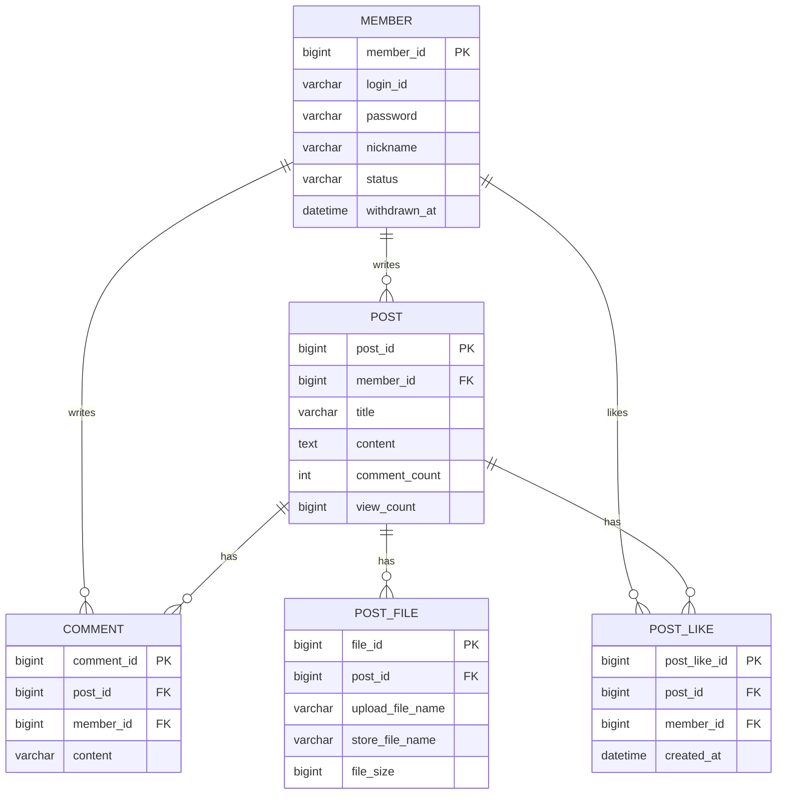

# Board

Spring Boot와 MySQL을 사용해 백엔드 기본기를 학습하기 위한 게시판 프로젝트입니다.

[](https://github.com/galaxyfog0427/board/actions/workflows/ci.yml)


이 프로젝트는 각각의 기술 스택 강의를 학습 후 게시판이라는 프로젝트로 녹여 만드는 데서 시작했습니다. 기능을 하나씩 붙이는 동안 테스트는 늘 통과했습니다. 그런데 Redis와 MySQL을 일부러 멈춰 보자, 테스트가 잡지 못한 문제가 연달아 나왔습니다. 서버 에러가 로그인 화면으로 보였고, 요청 하나가 30초씩 매달렸고, 게시글만 저장되고 첨부파일은 사라졌습니다. 그때부터 관심이 "기능이 동작하는가"에서 "부품이 고장 났을 때 사용자와 운영자에게 무엇이 보이는가"로 옮겨 갔습니다. 아래 [문제 해결 기록](#문제-해결-기록)은 대부분 그 간격에서 나왔습니다.

## 한눈에 보기

세션 기반 인증 + JPA + Querydsl로 구성된 SSR 게시판입니다. 기술을 도입할 때마다 "왜 이 기술을, 왜 이 방식으로" 도입했는지 판단 근거를 남기는 것을 원칙으로 진행했습니다.

### 핵심 아키텍처 결정

- **Repository 인터페이스/구현체 분리 설계**로 JDBC → JPA 전환을 Controller/Service 코드 변경 없이 구현체 교체만으로 수행
- **N+1 문제**를 ToOne 관계 fetch join + `default_batch_fetch_size` 안전망으로 해결하고, `open-in-view=false`로 지연 로딩 위험 제거
- **게시글 동시 수정 충돌**을 낙관적 락(`@Version`)으로 제어, 더티 체킹 타이밍 문제는 명시적 `flush()`로 해결
- **CSRF는 활성화**하되, WebFlux·HTTP Basic·동시 세션 제어·OAuth2 소셜 로그인 등은 게시판 규모 대비 실익이 낮다고 판단해 의도적으로 배제
- **Redis는 데이터 성격에 따라 원본 위치를 다르게** — 좋아요는 DB가 원본이고 Redis는 커밋 후 반영되는 사본, 조회수는 반영 전 증가분만 Redis에 모았다가 1분마다 DB에 일괄 반영, 세션은 Redis가 유일한 저장소
- **Redis 장애가 서비스 장애로 번지지 않게** — 명령 타임아웃 500ms, 연결이 끊기면 즉시 거절, 사본 데이터는 DB 폴백. 단 세션은 폴백이 불가능한 단일 장애 지점(SPOF)임을 인지하고, 운영이라면 Sentinel 또는 관리형 다중 가용 영역 구성으로 이중화한다고 판단
- **장애는 빨리, 숨기지 않고 실패하게** — DB 커넥션 대기를 30초에서 3초로 줄이고, 서버 에러가 로그인 화면으로 위장되던 문제를 제거. 없는 파일은 원인에 따라 로그 레벨을 나눠 404로 응답(첨부 정보가 없으면 WARN, 정보는 있는데 파일이 없으면 데이터 불일치이므로 ERROR)
- **파일 저장소는 인터페이스 뒤로** — `FileStore`가 디스크 경로 대신 `Resource`를 돌려주게 바꿔, 디스크(`LocalFileStore`)와 S3(`S3FileStore`)를 설정값 하나로 전환. 컨트롤러는 어느 저장소인지 모름
- **반쪽 저장 대신 고아 파일** — DB와 파일 저장소는 한 트랜잭션으로 묶을 수 없으므로, 파일을 먼저 저장하고 게시글과 첨부 정보는 한 트랜잭션으로 저장. 실패하면 올린 파일을 보상 삭제해서, 남을 수 있는 반쪽은 사용자에게 보이지 않는 고아 파일뿐
- **테스트는 운영과 같은 MySQL·Redis로** — Testcontainers로 Docker만 있으면 어디서든 실행되고, 스키마는 Flyway로 버전 관리. Redis 장애 시 폴백 동작은 Mockito로 장애를 재현해 검증
- **Docker Compose로 한 번에 실행** — app·MySQL·Redis(선택: LocalStack)를 compose로 구성. 멀티 스테이지 빌드, 비루트 사용자, healthcheck 기반 기동 순서, graceful shutdown
- **push마다 깨끗한 환경에서 검증** — GitHub Actions에서 전체 테스트를 돌리고, 통과한 커밋만 이미지를 빌드

## 실행 방법

필요한 것은 Docker(Compose 포함)뿐입니다.

### 기본 실행 (첨부파일은 디스크에 저장)

```bash
cp .env.example .env      # DB_PASSWORD에 원하는 값 입력
docker compose up -d --build
```

http://localhost:8080 으로 접속합니다.

### S3 모드 (LocalStack, 선택)

[LocalStack](https://www.localstack.cloud/) 인증 토큰이 필요합니다. `.env`에 아래 두 줄을 추가합니다.

```
LOCALSTACK_AUTH_TOKEN=발급받은_토큰
FILE_STORE=s3
```

```bash
docker compose --profile s3 up -d --build
```

LocalStack이 준비되면 `board-files` 버킷을 자동으로 만들고, 데이터는 볼륨에 보존합니다. 토큰이 없으면 이 단계는 건너뛰면 되고, 기본 실행은 그대로 동작합니다.

### 테스트

```bash
./gradlew test
```

Docker만 켜져 있으면 Testcontainers가 MySQL·Redis를 띄워서 실행합니다. 환경 변수(`.env`)는 필요 없습니다. main에 push하거나 PR을 올리면 GitHub Actions가 같은 테스트를 자동으로 실행합니다.

### ERD


---

## Post 테이블
| 컬럼 | 타입 | 설명 |
|---|---|---|
| post_id | BIGINT | 게시글 식별자, PK, AUTO_INCREMENT |
| member_id | BIGINT | 작성자, FK (member.member_id 참조) |
| title | VARCHAR(200) | 게시글 제목 |
| content | TEXT | 게시글 내용 |
| comment_count | INT | 댓글 개수 (역정규화, 기본값 0) |
| view_count | BIGINT | 조회수 (Redis에 쌓인 증가분을 1분마다 반영, 기본값 0) |
| created_at | DATETIME | 작성 시간 |
| updated_at | DATETIME | 수정 시간 |
| version | BIGINT | 낙관적 락 버전 (동시 수정 충돌 감지, 기본값 0) |

## Member 테이블
| 컬럼 | 타입 | 설명 |
|---|---|---|
| member_id | BIGINT | 회원 식별자, PK, AUTO_INCREMENT |
| login_id | VARCHAR(50) | 로그인 ID, UNIQUE |
| password | VARCHAR(255) | 비밀번호 |
| nickname | VARCHAR(50) | 닉네임 |
| status | VARCHAR(20) | 회원 상태 (ACTIVE / WITHDRAWN), 기본값 ACTIVE |
| withdrawn_at | DATETIME | 탈퇴 시각 (NULL 허용) |
| created_at | DATETIME | 가입 시간 |
| updated_at | DATETIME | 수정 시간 |

## Comment 테이블
| 컬럼 | 타입 | 설명 |
|---|---|---|
| comment_id | BIGINT | 댓글 식별자, PK, AUTO_INCREMENT |
| post_id | BIGINT | 게시글, FK (post.post_id 참조) |
| member_id | BIGINT | 작성자, FK (member.member_id 참조) |
| content | VARCHAR(1000) | 댓글 내용 |
| created_at | DATETIME | 작성 시간 |
| updated_at | DATETIME | 수정 시간 |

## Post_file 테이블
| 컬럼 | 타입 | 설명 |
|---|---|---|
| file_id | BIGINT | 파일 식별자, PK, AUTO_INCREMENT |
| post_id | BIGINT | 게시글, FK (post.post_id 참조) |
| upload_file_name | VARCHAR(255) | 사용자가 업로드한 원본 파일명 |
| store_file_name | VARCHAR(255) | 저장소 안의 파일명 (UUID + 원본 확장자). 디스크의 파일명이자 S3의 키 |
| file_size | BIGINT | 파일 크기 (byte) |
| created_at | DATETIME | 업로드 시간 |

## Post_like 테이블
| 컬럼 | 타입 | 설명 |
|---|---|---|
| post_like_id | BIGINT | 좋아요 식별자, PK, AUTO_INCREMENT |
| post_id | BIGINT | 게시글, FK (post.post_id 참조) |
| member_id | BIGINT | 좋아요를 누른 회원, FK (member.member_id 참조) |
| created_at | DATETIME | 좋아요 시각 (일별 랭킹의 날짜 기준, 앱 시각을 초 단위로 저장) |

`(post_id, member_id)` UNIQUE 제약으로 한 회원은 한 게시글에 한 번만 좋아요할 수 있다. 이 유니크 인덱스가 게시글별 좋아요 수 조회(`COUNT`, `GROUP BY`)도 함께 처리한다.

## 테이블 정의
정확한 DDL(컬럼 타입, 제약조건, 인덱스)의 원본은 Flyway 마이그레이션 파일입니다.
→ [`src/main/resources/db/migration`](./src/main/resources/db/migration)


## 학습 진행 상황

### 구현

#### JDBC 기초
- Spring Boot 프로젝트 초기 설정
- MySQL 연결 및 'post' 테이블 생성
- SQL CRUD 직접 실행
- JDBC 기본 동작 원리 학습
- `Connection`, `PreparedStatement`, `ResultSet` 사용
- 순수 JDBC로 게시글 CRUD 구현
- `AUTO_INCREMENT`로 생성된 게시글 ID 처리
- CRUD 반복 테스트 완료
- DataSource를 이용한 커넥션 획득 방식 추상화
- DriverManagerDataSource 적용
- HikariCP 커넥션 풀 적용

#### 트랜잭션
- post 테이블에 member_id, comment_count 컬럼 추가 (역정규화)
- member, comment 테이블 생성
- Member, Comment 도메인 및 Repository 구현 (순수 JDBC)
- Repository를 스프링 빈으로 전환, application.properties 기반 DataSource/TransactionManager 자동 등록 적용
- 트랜잭션 개념 학습 (원자성, 커밋/롤백, 자동/수동 커밋)
- 댓글 작성 + comment_count 증가 로직에 @Transactional 적용
- 트랜잭션 롤백 테스트 작성 (의도적 예외 발생 . 전체 롤백되는 것을 검증)

#### 예외 처리
- 체크 예외 vs 언체크 예외 차이 학습
- Post/Member/Comment Repository를 JdbcTemplate으로 전환
- SQLException 누수 문제 해결 (JdbcTemplate이 DataAccessException으로 자동 변환)
- 조회 결과 없음 처리를 EmptyResultDataAccessException으로 통일 (직접 예외 클래스 제거)
- 테스트를 @Transactional 기반 자동 롤백 방식으로 전환

#### Spring MVC
- 서블릿 -> MVC 패턴 -> 프론트 컨트롤러 -> DispatcherServlet 구조 학습
- 핸들러 매핑 / 핸들러 어댑터 / 뷰 리졸버로 이어지는 요청 처리 흐름 이해
- `@RequestMapping`. `@RequestParam`, `@ModelAttribute` 등 요청 매핑 / 파라미터 바인딩 학습
- `PostRepository.findAll()`, `CommentRepository.findByPostId()` 추가 (게시글 목록 / 댓글 목록 조회 준비)
- 동시간대 생성 데이터의 정렬 안정성을 위한 타이브레이커(`post_id`, `comment_id`) 적용 및 검증 테스트 작성
- Thymeleaf 기반 게시글 목록/상세/등록/수정(CRUD) 페이지 - 구현
- 폼 전송 객체(`PostForm`)를 도메인 객체(`Post`)와 분리 - Mass Assignment 방지 및 도메인 불변성 유지
- PRG 패턴 적용 및 `RedirectAttributes`로 새로고침 중복 등록 문제 해결
- 타임리프 유틸리티 객체(`#temporals`)로 날짜 포맷팅, `th:if`/`th:unless`로 빈 목록 처리
- 등록/수정 폼을 `th:object`, `th:field` 기반으로 개선 (id/name/value 자동 처리, 수정 폼에서 작성자 필드 제거)
- 화면 문구를 `messages.properties`로 외부화 (다국어는 실제 요구사항이 아니라 스킵, 메시지 외부화만 적용)
- Bean Validation 적용, 폼 객체를 등록용(`PostSaveForm`)/수정용(`PostEditForm`)으로 분리하여 검증 중복 방지
- 회원가입(`MemberController`, 로그인 ID 중복 확인용 `Validator` + `@InitBinder`) 및 로그인/로그아웃(`HttpSession` 기반) 구현
- 게시글 작성 시 작성자를 폼 직접 입력 대신 세션의 로그인 회원 정보로 자동 처리
- 스프링 인터셉터(`HandlerInterceptor`)로 로그인 인증을 공통 처리, `WebMvcConfigurer`로 등록
- 로그인 성공 후 원래 요청 경로로 복귀하는 `redirectURL` 처리
- `@SessionAttribute`로 세션 조회 코드 최소화
- 게시글 수정 시 작성자 본인 확인 추가
- 스프링 부트 기본 오류 처리(`BasicErrorController`) 활용, `templates/error/4xx.html, 5xx.html` 등록으로 기본 스프링 에러 페이지 대체
- `@ControllerAdvice`, `@ExceptionHandler`로 예외 처리 로직 일원화
- 영속성 계층 예외(`EmptyResultDataAccessException`)를 도메인 예외(`PostNotFoundException`) 변환 책임을 Repository로 이동
- Repository를 인터페이스/구현체로 분리 (`PostRepository` -> `JdbcTemplatePostRepository` 등) 추후 JPA 전환 시 Controller/Service 코드 변경 없이 구현체만 교체 가능하도록 설계
- 게시글 파일 첨부 기능 구현 - 종류/개수 제한 없이 업로드로 용량만 제한
- `FileStore` 인터페이스로 저장 방식을 추상화 (`LocalFileStore` 구현, 추후 S3 등으로 교체 가능하도록 설계)
- MockMvc 기반 Controller 계층 테스트 추가 (`PostControllerTest`, `MemberControllerTest`, `LoginControllerTest`)

#### JPA
- Member/Post/Comment를 JPA 엔티티로 매핑, `protected` 기본 생성자 추가
- Member.status를 String에서 MemberStatus enum으로 전환
- DB DEFAULT 컬럼(status, created_at, updated_at, comment_count)에 의존하던 로직이 JPA에서는 깨지는 것을 확인, `@PrePersist`/`@PreUpdate`로 엔티티가 null로 넘어가지 않고 기본값을 직접 책임지도록 수정
- MemberRepository, CommentRepository, PostRepository를 `JpaRepository` 상속으로 전환, 기존 JdbcTemplate 구현체는 빈 등록만 해제하고 참고용으로 보존
- `CommentRepository.findByPostId`는 원본 정렬 순서 유지를 위해 `@Query`로 직접 작성
- `PostRepository.incrementCommentCount()`는 `@Modifying` 벌크 쿼리로 전환
- `PostRepository.findAll()`을 인터페이스 내 `default` 메서드로 재정의하여 기존 정렬 기준(created_at DESC, post_id DESC) 유지
- 게시글 수정 로직을 Repository의 명시적 update() 대신 변경 감지(더티 체킹) 기반으로 전환, 이를 위해 `PostService` 신설 (트랜잭션 경계와 `PostNotFoundException` 변환 책임을 기존 Repository에서 Service로 이동)
- `ddl-auto=validate`로 JPA 엔티티 매핑과 기존 DDL 스키마의 정합성 검증

#### 페이징 처리
- 게시글 목록에 `Page`/`Pageable` 적용, 기본 10건씩 최신순(`createdAt`, `id` DESC)으로 조회
- 페이지 번호는 내부적으로 0부터 시작하지만, 화면에는 1부터 시작하는 번호로 변환해서 표시
- Post와 Member를 연관관계 매핑 없이 ON 조건으로 JOIN, JPQL 생성자 표현식으로 목록 전용 DTO(`PostListItem`)에 바로 매핑해 작성자 닉네임 함께 조회
- count 쿼리는 목록 조회 쿼리와 분리(`@Query`의 `countQuery`)해 불필요한 JOIN 제거
- 테스트 작성 중 테스트가 기존 DB 데이터와 공유되어 결과가 흔들리는 문제, 정렬 없는 페이징은 순서가 보장되지 않는다는 점을 직접 겪고 수정

#### JPA Auditing
- 손으로 관리하던 @PrePersist/@PreUpdate 기반 시간 처리를 Spring Data JPA Auditing으로 전환
- BaseTimeEntity(@MappedSuperclass)에 @CreatedDate/@LastModifiedDate 공통화, @EnableJpaAuditing 활성화
- 값이 항상 자동으로 채워지는 필드는 엔티티 생성자에서 아예 제거해 "받지만 안 쓰는" 파라미터를 없앰

#### 연관관계 매핑 (Post/Comment → Member/Post)
- Post.memberId, Comment.postId/memberId(Long)를 실제 객체 참조(@ManyToOne)로 전환
- 외래 키를 가진 쪽을 연관관계의 주인으로 설정, 양방향 대신 단방향으로만 매핑(불필요한 컬렉션/toString 순환 참조 방지)
- 모든 @ManyToOne에 fetch = LAZY 명시적으로 설정 (기본값 EAGER 회피)
- 순수 JdbcTemplate 참고용 구현체(Post/Comment)는 생성자 시그니처 변경으로 삭제, Git 히스토리로 이력 보존

#### REST API (학습용)
- `/api/v1/posts`(목록), `/api/v1/posts/{id}`(상세) — 실제 화면에서 사용하지 않는 학습 목적의 엔드포인트, JPA 조회 성능 최적화 실습용
- 응답을 `ApiResponse<T>`(success/data/message)로 통일, `Page`는 그대로 노출하지 않고 `PageResponse`로 변환해 API 스펙을 직접 통제
- API 전용 예외 처리(`ApiExceptionHandler`)를 `com.example.board.api` 패키지로 스코프 분리
- 댓글 상세 조회에서 작성자를 개별 지연 로딩으로 가져오며 N+1 발생을 직접 확인(SQL 로그로 post 1회 + 댓글 목록 1회 + 서로 다른 작성자 수만큼 추가 조회)

#### 조회 성능 최적화 (N+1, fetch join, OSIV)
- 학습용 API 상세 조회에서 댓글 작성자를 개별 지연 로딩하며 N+1을 직접 재현하고 SQL 로그로 확인
- ToOne 관계(Post.member, Comment.member)에 fetch join을 적용해 쿼리 수를 최소화 (컬렉션이 아니므로 페이징에 영향 없음)
- hibernate.default_batch_fetch_size를 전역 설정으로 추가해, fetch join을 걸지 않은 지연 로딩 지점에 대한 안전망 확보
- spring.jpa.open-in-view=false로 전환 — 기존 fetch join 최적화 덕분에 추가 코드 변경 없이 정상 동작 확인

#### Querydsl 도입
- 유지보수가 멈춘 원본 com.querydsl 대신 활발히 관리되는 OpenFeign 포크(io.github.openfeign.querydsl) 사용
- PostRepositoryCustom/PostRepositoryImpl 패턴으로 스프링 데이터 JPA와 연동 (이름 규칙: `<Repository명>Impl`)
- 게시글 제목/작성자 닉네임을 선택적으로 조합 검색 가능한 동적 쿼리 구현 (Where 다중 파라미터 방식)
- 검색 조건에 따라 count 쿼리의 join 여부를 다르게 해 불필요한 조인 비용 최적화

#### 동시성 제어 (낙관적 락)
- 게시글 동시 수정 시 Lost Update가 발생할 수 있음을 확인, `@Version` 기반 낙관적 락으로 해결
- 더티 체킹으로 인한 UPDATE는 트랜잭션 종료 시점에 실행되므로, `editPost()` 내에서 명시적 `flush()`를 호출해 충돌을 그 자리에서 감지
- `ObjectOptimisticLockingFailureException`을 `PostEditConflictException`으로 변환해 일관된 예외 처리 유지

#### Spring Security 도입
- 스프링 시큐리티 초기화 구조(SecurityBuilder, WebSecurity, FilterChainProxy, DelegatingFilterProxy) 학습
- 인증 프로세스(폼 인증, 기본 인증, RememberMe, 익명 인증, 로그아웃, 요청 캐시) 및 각 필터의 역할 학습
- 인증 아키텍처(Authentication, SecurityContext, AuthenticationManager, AuthenticationProvider, UserDetailsService) 학습
- 세션 기반 수동 인증(HttpSession, LoginCheckInterceptor)을 Spring Security로 전면 전환
- `CustomUserDetailsService`/`MemberDetails`로 UserDetailsService 커스터마이징 - Member 도메인 객체를 UserDetails 규격에 맞게 어댑팅
- BCryptPasswordEncoder 적용, 회원가입 시 비밀번호 암호화 저장
- `formLogin()`/`logout()`으로 로그인·로그아웃 처리를 필터 체인에 위임, 컨트롤러의 수동 세션 생성 로직 제거
- 손으로 관리하던 `redirectURL` 파라미터를 RequestCache/SavedRequest 표준 메커니즘으로 대체
- `authorizeHttpRequests()`로 인가 로직을 인터셉터 대신 SecurityFilterChain으로 이전
- 컨트롤러의 `@SessionAttribute` 기반 로그인 회원 조회를 `@AuthenticationPrincipal`로 전환
- MockMvc 테스트를 spring-security-test(`user()`, `authenticated()`/`unauthenticated()`) 기반으로 재작성
- 세션 관리(동시 세션 제어, 세션 고정 보호) 학습 - 동시 세션 제어는 게시판 성격상 불필요하다고 판단해 미적용, 세션 고정 보호는 기본 활성화된 채로 유지
- CSRF 보호 활성화 - Thymeleaf의 자동 hidden 토큰 삽입 활용, MockMvc 테스트는 spring-security-test의 csrf()로 대응
- OAuth2/OpenID Connect 개념 학습(4대 역할, Authorization Code Grant 흐름, Access/ID Token 구분, OAuth2UserService의 UserDetailsService 대응 구조)
- 실제 소셜 로그인은 회원 스키마 변경(비밀번호 nullable화 등) 비용 대비 실익이 낮다고 판단해 board엔 미적용, 개념 이해까지만 진행

#### Redis 도입 (조회수, 좋아요, 인기글 랭킹, 세션)
- 『개발자를 위한 레디스』로 자료구조, 캐싱 전략, 영속성, 복제, Lua를 학습한 뒤 설계 원칙을 먼저 정하고 적용
  - 확인과 변경은 명령 하나로(check-then-act 금지), O(n) 명령 금지, 모든 키에 수명 지정(원본 키 제외), Redis에는 DB 커밋이 확정된 사실만 반영, Redis의 파생 데이터는 DB로 재구성 가능하게
- 키 이름은 `RedisKeys` 한 곳에서만 생성(`board:` 접두사), 테스트는 Testcontainers의 일회용 Redis 사용
- **조회수**: `SET NX EX 600`으로 10분 내 중복 조회 방지(회원은 id, 비회원은 UUID 쿠키) → Sorted Set에 증가분 누적 → 1분마다 `JdbcTemplate` 배치 UPDATE 후 읽은 만큼만 `ZINCRBY -n`으로 차감(그 사이 들어온 조회수 보존)
  - 화면 조회수 = DB 값 + Redis 증가분, 목록은 `ZMSCORE` 한 번으로 10개 조회
- **좋아요**: `post_like` 테이블이 원본. `INSERT IGNORE`와 UNIQUE 제약으로 멱등 처리, 커밋 후(`@TransactionalEventListener(AFTER_COMMIT)`) Lua 스크립트로 좋아요 Set과 일별 랭킹을 원자적으로 반영
  - 상세 페이지는 Set 캐시(1시간)로 좋아요 수와 내 상태를 한 번에 조회, 없으면 DB에서 재구성. 좋아요 0개 글도 캐시되도록 센티넬 멤버 사용
  - 목록의 좋아요 수는 Redis 대신 DB `GROUP BY` 한 방(`SCARD`가 "캐시 없음"과 "0개"를 구분하지 못해 설계 변경)
  - 요청 결과가 캐시와 어긋나면(이미 누름, 이미 취소) 캐시를 삭제해 다음 조회에서 재구성되도록 자가 복구
- **인기글 랭킹**: 일별 Sorted Set(8일 수명) → 1분마다 최근 7일을 `ZUNIONSTORE`로 합산(결과 키 5분 수명, 멱등) → 상위 10개를 DB와 대조해 표시
- **세션**: Spring Session으로 저장소를 Redis로 전환해 재시작 후에도 로그인 유지. 세션에는 엔티티 대신 회원 id, 로그인 id, 닉네임만 담은 직렬화 가능한 스냅샷을 저장하고 비밀번호는 인증 후 삭제
- **장애 대응 실험**: Redis를 직접 중단해 요청당 약 1초 지연을 측정, 연결 끊김 시 즉시 거절하도록 바꿔 0ms로 개선. 장애 로그는 스택트레이스 대신 원인 한 줄로
- 의도적으로 넣지 않은 것: 서킷 브레이커(Redis 하나에 대비 실익이 작음), 세션 Redis 이중화(학습 규모), 좋아요 수 반정규화(현재는 `COUNT`로 충분), 랭킹 재집계 배치
- 조회수 반영 중 DB 커밋 후 Redis 차감이 실패하면, 그 묶음이 다음 주기에 한 번 더 더해질 수 있음(이중 가산). 막으려면 반영한 묶음을 DB 트랜잭션 안에 함께 기록하는 멱등 처리가 필요하지만, 발생 구간이 매우 좁고 학습 규모에 비해 과해 미적용

#### Kafka (학습용, `study/kafka` 브랜치 — main 미반영)
- 코드: [`study/kafka` 브랜치](https://github.com/galaxyfog0427/board/tree/study/kafka)
- board에는 Kafka가 꼭 필요한 기능이 없다고 판단해 main에 넣지 않고 별도 브랜치에서 학습
- 로컬 Kafka 4.0(KRaft) 단일 브로커를 Docker Compose로 구성, 호스트용·컨테이너 내부용 리스너 분리
- 회원가입 커밋 후(`@TransactionalEventListener(AFTER_COMMIT)`) `member.joined` 토픽에 회원 ID를 key로 발행 → 별도 패키지의 컨슈머가 환영 메일 발송(느린 외부 호출을 3초 대기로 흉내)
- 프로듀서와 컨슈머가 서로의 클래스를 참조하지 않고 토픽 이름과 JSON 형식만 공유하도록 분리
- Kafka 장애 시 회원가입이 최대 60초 멈추지 않도록 `max.block.ms`를 1초로 제한
- 알고 있는 한계: 커밋 후 발행 실패 시 메시지 유실(반드시 보내야 하는 메시지는 Transactional Outbox), 최소 한 번 전달로 인한 중복 처리 가능(컨슈머 멱등성). 다음 프로젝트에서 다룰 예정

#### 테스트 보강
- 기존 테스트 25개를 의존 대상별로 분류해 문제를 먼저 진단
  - 23개가 로컬 MySQL·Redis에 묶여 다른 환경(CI 포함)에서 실행 불가
  - 테스트 DB 스키마를 손으로 관리
  - Redis 장애 대응 코드(catch) 12곳이 자동 테스트로 한 번도 실행되지 않음
- **Mockito**: Redis 연결 실패를 재현해 사용자 요청 경로의 폴백 6곳(조회수 조회·목록 반영·증가, 좋아요 상태 조회·캐시 재구성, 인기글)을 단위 테스트로 검증
  - 반환값이 없는 동작은 호출 여부로 검증 (중복 확인 실패 시 증가 명령 미전송, 인기글 장애 시 DB 미조회)
  - 대상 코드의 catch를 일부러 제거해 테스트가 실패하는지 확인
  - 스케줄러·이벤트 리스너의 나머지 6곳은 로그만 남기고 다음 주기나 다음 요청에서 다시 시도하는 구조라, 테스트로 지킬 동작이 없다고 판단해 생략
- **댓글 롤백 테스트 재작성**: 운영 코드에 심어 둔 테스트 전용 분기를 제거하고 `@MockitoBean`으로 댓글 수 증가 실패를 재현. 테스트 트랜잭션 없이 저장된 댓글이 실제로 롤백되는지 DB에서 확인
- **Flyway**: 현재 스키마를 실제 DB 덤프에서 추출해 V1 마이그레이션으로 기록하고, 기존 DB는 baseline으로 편입. Flyway가 스키마를 만들고 Hibernate는 `validate`로 검사만 담당
- **Testcontainers**: MySQL·Redis를 static 싱글톤 컨테이너로 띄우고 `@ServiceConnection`으로 연결해, Docker만 있으면 전체 테스트 실행 가능
  - H2 대신 실제 MySQL을 쓴 이유: `INSERT IGNORE`, `ON UPDATE CURRENT_TIMESTAMP`, Lua 스크립트처럼 운영 환경 고유의 동작을 그대로 검증하기 위해
  - 컨테이너는 공유하고, 테스트 간 격리는 트랜잭션 롤백과 `@AfterEach` 정리로 유지

#### Docker 컨테이너화
- 멀티 스테이지 빌드: JDK 이미지에서 빌드하고 JRE 이미지로 실행해 이미지 크기와 공격 표면(컴파일러 등 실행에 불필요한 도구)을 줄임
- 의존성 다운로드를 소스 복사보다 먼저 두어 레이어 캐시 활용 (소스만 바꾼 재빌드 54.9초 → 19.7초)
- 비루트 사용자(`app`)로 실행하고, 업로드 폴더를 이미지에서 미리 만들어 소유권을 `app`에게 부여
- exec 형식 `ENTRYPOINT`로 java가 PID 1이 되어 종료 신호(SIGTERM)를 직접 받음. Spring graceful shutdown(30초)보다 compose의 `stop_grace_period`(40초)를 길게 잡아 처리 중인 요청을 끝내고 종료
- Docker Compose로 app·MySQL·Redis 구성
  - 컨테이너끼리는 서비스 이름으로 접속(사용자 정의 네트워크의 내장 DNS). 컨테이너 안의 `localhost`는 자기 자신이라는 점을 직접 겪고 정리
  - MySQL·Redis에 healthcheck를 두고 `depends_on: condition: service_healthy`로 기동 순서 보장
  - 비밀번호는 `.env`(커밋 제외)로 주입하고 `.env.example`만 커밋
- 설정값은 이미지 밖에서 주입: 기본값은 `application.properties`의 `${DB_HOST:localhost}` 형태로, 환경별 값은 환경 변수로. 이미지는 하나, 환경 차이는 바깥에서
- Redis 운영 설정 파일 분리: AOF `everysec` + RDB 스냅샷, `maxmemory 256mb` + `noeviction`, 데이터는 볼륨에 보존
- MySQL 8.0 → 8.4 업그레이드: 되돌릴 수 없는 업그레이드라 `mysqldump`로 논리 백업을 먼저 받고 진행. Testcontainers의 MySQL 버전도 운영과 맞춤

#### 파일 저장소 추상화와 S3 (LocalStack)
- **추상화 누수 수정**: `FileStore.getFullPath()`가 디스크 경로를 돌려줘서 컨트롤러가 `"file:" + 경로`로 디스크를 직접 열고 있었음. S3로 바꾸면 컨트롤러까지 깨지는 구조라 `Resource load(String storeFileName)`로 변경
  - `FileUrlResource` 대신 `FileSystemResource`를 고른 이유: 체크 예외(`MalformedURLException`)가 없어 인터페이스에 구현 사정이 새지 않음
  - 트레이드오프: 인터페이스가 Spring의 `Resource`에 의존. 프로젝트가 Spring을 떠날 일은 없고 저장소는 실제로 바뀌므로 수용
- **설정값 하나로 저장소 전환**: `board.file-store=${FILE_STORE:local}`과 `@ConditionalOnProperty`. 값이 없으면 디스크(`matchIfMissing`), `s3`면 S3. 오타가 나면 어느 쪽도 등록되지 않아 앱이 시작 단계에서 실패(조용히 디스크로 넘어가지 않음)
- **LocalStack 구성**: compose의 `profiles: ["s3"]`로 분리해, 토큰이 없는 사람은 기본 실행만으로 동작. 이미지는 숫자 태그로 고정(`2026.10.4`)
  - 버킷 자동 생성: 준비 완료 시 실행되는 스크립트에서 버킷이 있는지 먼저 확인하고 없을 때만 생성(여러 번 실행해도 결과가 같게)
  - 데이터 보존: 볼륨 연결. DB만 남고 저장소가 비면 개발 환경에서만 깨진 첨부가 생기므로 운영 S3와 같은 조건으로 맞춤
- **S3FileStore**: AWS SDK v2. 앱이 시작할 때 `headBucket`으로 버킷을 확인해 없으면 시작 실패. `endpointOverride`, `forcePathStyle`, 테스트용 자격 증명은 LocalStack 전용 설정
- **저장 파일 이름 생성 분리**(`StoreFileNames`): 두 구현의 중복을 없애면서 확장자가 없는 이름(`README`), 점으로 끝나는 이름(`cat.`), `null`을 처리하지 못하던 버그를 함께 수정. `@ParameterizedTest`로 검증
- **저장소 이전**: 디스크 모드에서 올린 첨부를 S3 모드에서 열면 깨짐. 저장 파일 이름이 곧 S3 키라서, 파일을 같은 이름으로 버킷에 복사(`aws s3 sync`)하는 것만으로 DB를 한 줄도 고치지 않고 복구

#### CI (GitHub Actions)
- `.github/workflows/ci.yml`: main push와 PR마다 실행
- `test` 잡: 코드 받기 → JDK 17(temurin, Dockerfile의 실행 이미지와 같은 배포판) → Gradle 준비(의존성 캐시, wrapper 검증) → `./gradlew test`. 러너에 Docker가 있어 Testcontainers가 그대로 동작
- `build-image` 잡: `needs: test`로 테스트가 성공한 커밋만 이미지를 빌드(`board:<커밋 ID>`). 레지스트리에는 올리지 않고 Dockerfile이 깨지지 않았는지만 검사
- 워크플로 권한은 `contents: read`만(최소 권한). 액션은 Marketplace의 최신 메이저 버전으로 고정
- 올리기 전에 로컬에서 CI 조건을 흉내 냄: 환경 변수를 지운 채 `./gradlew test --rerun-tasks`로 실행(Gradle이 입력 변화가 없다며 테스트를 건너뛰는 `up-to-date`를 피하기 위해), `gradlew` 실행 권한(`100755`) 확인

### 데이터베이스 설계
- 개념적/논리적 모델링 설계 완료 (Member/Post/Comment 엔티티, 관계, 참여도, 식별 여부 확정)
- 물리적 모델링 완료 (데이터 타입, 제약조건, 역정규화 확정)

## 문제 해결 기록

### 게시글 수정이 댓글 수를 과거 값으로 덮어쓰던 문제
- **문제**: 게시글을 수정하는 사이 댓글이 달리면 댓글 수가 수정 전 값으로 되돌아감
- **원인**: 더티 체킹이 만드는 UPDATE가 바뀐 컬럼만이 아니라 모든 컬럼을 포함함. 벌크 쿼리로 올린 `comment_count`는 `@Version`을 올리지 않아 낙관적 락도 막지 못함
- **해결**: 카운터 컬럼에 `@Column(updatable = false)`를 걸어 엔티티 UPDATE에서 제외. 이후 추가한 `view_count`도 처음부터 같은 방식 적용
- **확인**: 조회 → 벌크 증가 → 수정 저장 순서를 재현하는 테스트로 수정 전 실패, 수정 후 통과 확인

### Redis 장애 시 요청마다 1초씩 지연되던 문제
- **문제**: Redis를 중단하면 페이지는 뜨지만 상세 조회마다 약 1초씩 지연
- **원인**: Lettuce가 연결이 끊긴 동안 명령을 버퍼에 쌓고 재연결을 기다림. 명령 2개가 각각 타임아웃 500ms를 기다림
- **해결**: 연결이 끊기면 명령을 즉시 거절하도록 설정(`REJECT_COMMANDS`), 장애 로그도 원인 한 줄로 축약
- **확인**: 로그 타임스탬프로 실패 간격 500ms → 0ms 측정, Redis 재기동 후 자동 재연결 확인
- **덧붙여**: 타임아웃 500ms(Lettuce 기본 60초에서 줄인 값)는 즉시 거절과 별개로 유지. 즉시 거절은 "끊긴 걸 아는" 경우만 막고, 연결은 살아 보이는데 응답이 없는 경우(무거운 명령, 감지되지 않은 네트워크 단절)는 타임아웃이 기다림의 상한

### 좋아요 동시 요청 문제
- **문제**: 같은 회원의 동시 좋아요 요청이 중복 저장 예외를 내고, 동시 취소 요청은 랭킹 점수를 요청 수만큼 깎을 수 있음
- **원인**: "확인 후 저장"과 "조회 후 삭제" 모두 두 단계 사이에 다른 요청이 끼어들 수 있음(check-then-act)
- **해결**: 좋아요는 `INSERT IGNORE` 한 문장으로 확인과 저장을 합치고 반환 행 수(0/1)로 결과 판단. 취소는 반환 행 수가 1일 때만 랭킹 차감 이벤트 발행
- **확인**: 스레드 10개를 `CountDownLatch`로 동시에 출발시키는 테스트로 저장 1건, 성공 1번, 예외 0건 검증

### 주간 랭킹 점수가 매분 불어나던 문제
- **문제**: 1분마다 주간 랭킹을 합산할 때마다 점수가 2 → 4 → 6으로 증가
- **원인**: `ZUNIONSTORE`의 입력에 결과 키 자신이 포함됨. `unionAndStore`의 첫 인자도 합칠 재료라는 점을 놓침
- **해결**: 입력을 일별 키 7개로만 구성
- **확인**: 두 번 실행해도 결과가 같은지 검증하는 멱등성 테스트로 재현 후 수정 확인

### 로그인 상태에서만 목록 화면이 깨지던 문제
- **문제**: 모든 테스트는 통과했지만 실제로 로그인 후 목록에 들어가면 오류 페이지 표시
- **원인**: 목록 화면에 `getReferenceById`로 만든 회원 프록시를 넘겼고, 화면 렌더링 시점(OSIV 비활성)에 프록시가 닉네임을 읽으려다 `LazyInitializationException` 발생. 테스트 설정만 OSIV가 켜져 있어 테스트에서는 재현되지 않음
- **해결**: 세션의 회원 스냅샷(`MemberDetails`)을 그대로 화면에 전달. 테스트 OSIV 설정을 운영과 일치
- **확인**: 로그인 상태 목록 테스트를 추가해 수정 전 실패, 수정 후 통과 확인

### 롤백 테스트가 롤백 없이도 통과하던 문제
- **문제**: `CommentService.addComment()`의 `@Transactional`을 지워도 롤백 테스트가 통과
- **원인**: 예외가 댓글 수 증가 전에 발생해서 "댓글 수가 0"이라는 검증이 롤백과 무관하게 항상 참이었고, 테스트 클래스의 `@Transactional`이 서비스 트랜잭션을 감싸 실제 커밋·롤백이 일어나지 않았음
- **해결**: 댓글 저장 후 증가 단계에서 예외를 재현(`@MockitoBean`), 테스트 트랜잭션 제거, 검증 대상을 "저장된 댓글이 DB에 남지 않았는가"로 변경
- **확인**: `@Transactional`을 제거하면 새 테스트가 실패하는 것을 확인

### 서버 에러가 로그인 화면으로 위장되던 문제
- **문제**: DB 장애 중에 비로그인 사용자가 목록에 접근하면 에러 화면이 아닌 로그인 화면이 떠서, 사용자에게 장애 사실 자체가 드러나지 않았음. 장애 중에도 요청마다 Redis에 쓸모없는 세션이 생성됨
- **처음 가설**: 원인을 처음에는 "에러가 나면 `/error`로 리다이렉트되는데 그게 막힌다"로 이해했으나, 로그를 확인하며 리다이렉트가 아니라 서버 안에서의 내부 전달(forward)이라는 점을 바로잡음
- **원인**: 처리되지 않은 예외가 나면 톰캣이 `/error`로 내부 전달하는데, `SecurityConfig`의 `permitAll()`에 `/error`가 없어서 Security에 막혀 `DispatcherServlet`까지 오지 못하고 로그인 페이지로 리다이렉트됨
- **테스트가 못 잡은 이유**: 기존 404 같은 예외는 `GlobalExceptionHandler`가 에러 화면을 직접 돌려줘서 `/error`를 거치지 않았고, `MockMvc`는 실제 톰캣이 아니라 예외가 나도 `/error`로 내부 전달하지 않음
- **해결**: `SecurityConfig`의 `permitAll()`에 `/error`를 추가해 로그인하지 않아도 에러 화면을 볼 수 있게 수정
- **확인**: 로그인 없이 `/error`에 접근하는 `MockMvc` 테스트로 수정 전 302(로그인 페이지), 수정 후 500을 확인. 실제 컨테이너에서도 DB를 중지한 뒤 `curl -i -H "Accept: text/html"`로 500 에러 화면이 뜨고 세션이 생성되지 않는 것을 확인

### DB 장애 시 요청이 30초씩 매달리던 문제
- **문제**: 앱이 떠 있는 중에 MySQL을 멈추고 목록을 요청하자 응답이 30초 뒤에 옴(로그: `request timed out after 30007ms`). 위의 "로그인 화면 위장" 문제와 같은 실험에서 함께 발견
- **원인**: 요청 스레드가 HikariCP에서 커넥션을 빌리려고 기본값 30초(`connection-timeout`)를 기다림. 이런 요청이 쌓이면 톰캣 스레드가 모두 묶여 DB와 무관한 요청까지 처리할 스레드가 없어짐
- **판단**: 너무 짧으면 잠깐 끊겼다 바로 복구되는 상황에도 실패하고, 너무 길면 스레드를 오래 잡음. 그래서 "1초 이상이되 길지 않게" 3초로 설정
- **해결**: `spring.datasource.hikari.connection-timeout=3000`
- **확인**: MySQL을 멈춘 뒤 `time curl`로 30초가 아닌 3.237초 만에 500이 오는 것을 확인
- **한계**: 3초는 측정이 아닌 가설값. 운영이라면 평소 커넥션 대기 시간을 측정해 정해야 함. DB와 무관한 요청이 덜 막히는지는 동시 요청 실험으로 아직 확인하지 않음

### 첨부파일 Content-Type이 브라우저 요청에 따라 바뀌던 문제
- **문제**: 진짜 PNG 파일(`file` 명령으로 확인)을 화면에 띄우면 응답의 `Content-Type`이 `image/avif`. curl로 `Accept`만 바꿔 보내자 `image/webp`, `*/*`이면 `application/json`이 옴(바이트는 PNG 그대로)
- **처음 가설**: "파일 내용이 실제로는 AVIF일 것" → `file` 명령으로 PNG임을 확인해 기각. "Spring이 저장 파일 확장자로 정한다" → 확장자가 png인데 avif가 나와서 기각
- **원인**: 컨트롤러가 `Content-Type`을 정하지 않아 콘텐츠 협상이 일어남. `Resource`를 쓰는 변환기는 모든 형식을 쓸 수 있다고 응답하므로, 브라우저가 보낸 `Accept`의 첫 형식이 그대로 선택됨
- **테스트가 못 잡은 이유**: 아무도 `Accept`를 바꿔 요청해 보지 않았음
- **해결**: 저장 파일 이름의 확장자로 서버가 직접 정함(`MediaTypeFactory`, 모르면 `application/octet-stream`). `Resource.getFilename()` 대신 DB의 저장 파일 이름을 쓴 이유는 S3의 스트림 기반 `Resource`에는 파일 이름이 없기 때문
- **확인**: `Accept: image/avif`로 요청해도 `image/png`, 모르는 확장자는 브라우저가 무엇이라고 보내든 `application/octet-stream`인지 검사하는 테스트. 실제로도 curl로 `Accept`를 바꿔 같은 응답이 오는 것을 확인

### 첨부파일 저장에 실패하면 게시글만 남던 문제 (반쪽 저장)
- **문제**: 업로드 폴더의 권한 문제로 파일 저장이 실패했는데, 사용자는 에러 화면을 봤지만 첨부 없는 게시글이 DB에 남아 있었음. 다시 쓰면 같은 글이 두 개가 됨
- **처음 가설**: "권한 문제라면 403이 뜰 것", "게시글은 먼저 저장되니 남고 파일만 안 될 것". 403은 요청한 사용자의 권한 문제에 쓰는 응답이고, 이번에는 서버 프로세스의 폴더 쓰기 권한 문제라 500이 맞았음. 두 번째 예측은 맞았음
- **원인 찾기**: 로그에는 처음에 `FileNotFoundException`(폴더 없음)만 보여 진짜 원인이 가려져 있었음. 폴더 생성을 `Files.createDirectories`로 바꾸자 `AccessDeniedException`이 드러남 → 폴더 주인이 root, 앱은 `app` 사용자로 실행 중이었음(Dockerfile에서 폴더 생성과 소유권 지정으로 해결)
- **반쪽 저장의 원인**: 게시글 저장이 먼저 커밋되고, 파일과 첨부 정보 저장은 그 트랜잭션 밖에서 이뤄짐
- **판단**: 순서를 바꿔도 반쪽 저장은 모양만 바뀜(파일만 남거나, 파일은 있는데 첨부 정보가 없거나). DB와 파일 저장소는 한 트랜잭션으로 묶을 수 없으므로 "어떤 반쪽을 남길 것인가"로 질문을 바꿈. 사용자에게 보이지 않는 고아 파일이 덜 나쁜 쪽
- **해결**:
  1. 파일을 먼저 저장소에 올림(트랜잭션 밖. 느린 업로드가 DB 커넥션을 붙잡지 않게)
  2. 게시글과 첨부 정보를 한 트랜잭션으로 저장(`PostService.saveWithFiles`)
  3. 실패하면 올린 파일을 삭제(보상). 삭제마저 실패하면 `[고아 파일]` ERROR 로그로 남김
  - `FileStore.delete`의 약속: 없는 파일을 지워도 예외 없이 넘어감(보상이 두 번 불려도 안전)
- **확인**: 첨부 정보 저장이 실패하도록 만든 테스트(`@MockitoBean`, 테스트 트랜잭션 없음)로 게시글 수와 저장소의 파일 수가 그대로인지 검사. 근본 원인 메시지까지 확인해 의도한 경로를 지났는지 검증하고, 보상 삭제 줄을 지우면 테스트가 실패하는 것을 확인

### 저장소에 파일이 없을 때 500이 나던 문제
- **문제**: 첨부 정보는 DB에 있는데 저장소에 파일이 없으면(깨진 참조) 이미지가 깨지고 500. 없는 첨부 번호로 요청해도 500
- **원인**: 저장소마다 "없음"을 알리는 예외가 다름(디스크는 응답을 쓰는 도중 `FileNotFoundException`, S3는 `NoSuchKeyException`). 컨트롤러가 각각 잡으면 컨트롤러가 모든 저장소를 알게 됨. 없는 첨부 번호는 리포지토리가 `EmptyResultDataAccessException`을 던짐
- **해결**:
  - `StoredFileNotFoundException`을 `FileStore`의 약속(`@throws`)으로 정하고, 각 구현이 자기 예외를 이 예외로 바꿔 던짐(원인 예외는 함께 보존). 디스크는 응답 전에 파일 존재를 직접 확인
  - 첨부 조회는 `Optional`로 바꾸고 없으면 `PostFileNotFoundException`
  - 둘 다 404로 응답하되 로그 레벨을 다르게: 첨부 정보가 없으면 WARN(잘못된 주소 요청일 수 있음), 정보는 있는데 파일이 없으면 ERROR(우리 데이터가 어긋남). 하나로 합치면 ERROR 로그가 잘못된 요청으로 가득 차 진짜 불일치가 묻힘
- **확인**: 두 경우 각각 404 테스트. 고친 코드를 되돌리면 실패하는 것을 확인. 실제 S3 모드에서도 404와 로그 레벨을 확인

## 알려진 한계와 다음 할 일

- **업로드 파일 내용 검증 없음**: 서버가 확장자(이름)를 믿음. 이름만 `.png`인 HTML 파일이 화면에 그대로 뜰 수 있어(저장형 XSS 위험), 파일 앞부분 바이트로 실제 형식을 확인하고 허용한 이미지만 받는 처리가 필요
- **한글 파일 이름 다운로드**: macOS에서 올린 파일 이름은 자모가 분리된 형태(NFD)로 내려가 윈도우에서 깨져 보일 수 있음
- **S3 모드의 `Content-Length` 없음**: 스트림으로 내려보내서 길이를 미리 알지 못함. 큰 파일을 받을 때 진행률이 표시되지 않음
- **저장소 모드 전환**: 디스크와 S3를 바꾸면 기존 첨부는 옮기기 전까지 보이지 않음(위의 `sync`로 이전)
- **고아 파일 정리 없음**: 보상 삭제마저 실패한 파일은 로그로만 추적
- **세션 저장소(Redis) 단일 장애 지점**
- **S3 설정은 LocalStack 전용**: 실제 AWS에서는 테스트용 자격 증명 대신 SDK 기본 자격 증명 체인을 써야 함
- **이미지를 레지스트리에 올리지 않음**: CI는 빌드 가능 여부까지만 검사. 배포(CD)는 이 프로젝트의 범위 밖
- **LocalStack(S3) 자동 테스트 없음**: S3 모드는 수동으로 확인. 토큰이 있을 때만 도는 테스트(`@EnabledIfEnvironmentVariable`)로 추가할 수 있음
- **트래픽이 커지면**: 지금은 업로드 바이트가 앱 서버를 거침. 대용량 업로드가 많아지면 앱 서버 스레드를 오래 잡으므로, 짧게 유효한 업로드 주소(presigned URL)로 브라우저가 S3에 직접 올리고, 다운로드는 CDN이나 짧게 유효한 주소로 내려주는 구조로 바꿀 것

## 설계 문서
- 데이터베이스 논리적 모델링 설계 결정사항 [docs/design.md](./docs/design.md) 참고